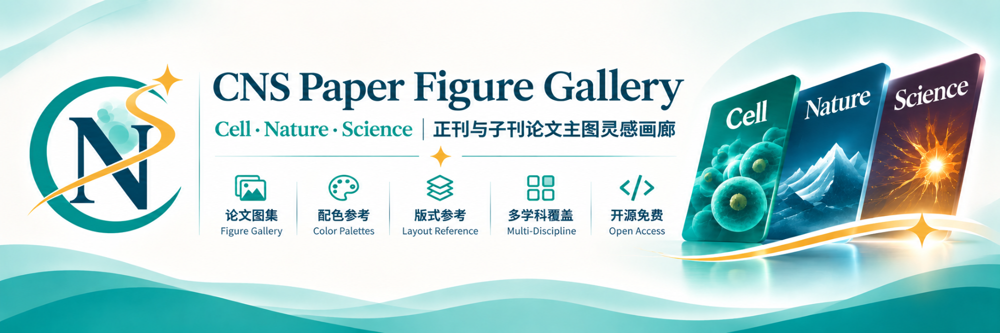

<div align="center">

<p align="center">🌐 <a href="README.md">简体中文</a> · <strong>English</strong></p>



# 🎨 CNS Paper Figure Gallery
### Figure 1 & Graphical Abstract inspiration from Cell, Nature, and Science journals · All Disciplines · 2024–2026

### 💖 Sponsorship and resource support

**Keep scientific figure inspiration open and help make curated visual design & palettes accessible across all disciplines.**

Individuals and organizations are welcome to support ongoing figure curation, automated monthly updates, and palette tools via **tips, AI model/API credits, or cloud compute**. Starring the repo, suggesting journals, and sharing with labmates are also warmly appreciated!

**♡ Support the author: [Jump to WeChat Pay QR](#-support-the-author) · Online Support Page: [support.html](https://daydayup-xq.github.io/cns-paper-figure-gallery/support.html)**

[](https://daydayup-xq.github.io/cns-paper-figure-gallery/)


-purple)

[](scripts/crawl_cns_figures.py)
[](LICENSE)
[](#-%EF%B8%8F-copyright)


<p align="center">🌐 <a href="README.md">简体中文</a> · <strong>English</strong></p>

Before drawing your paper's Figure 1, see how Cell, Nature, and Science compose and color theirs.  
A searchable, multi-dimensional Figure 1 & Graphical Abstract gallery with extracted 5-color palettes. Pure static, zero build, works offline.

[🌐 Live Gallery](https://daydayup-xq.github.io/cns-paper-figure-gallery/) ·
[🎨 Color Palettes](#-scientific-color-palettes) ·
[📊 Dataset Scale](#-dataset-scale) ·
[🧭 Visual Patterns](#-visual-patterns) ·
[🚀 Quick Start](#-quick-start) ·
[♡ Support the Author](#-support-the-author)

</div>

## 🤝 Sponsor Partners

Thanks to our sponsor partner supporting scientific writing and figure creation workflows alongside this open gallery. Click the banner or links below to explore.

<table>
  <tr>
    <td width="50%" valign="top">
      <a href="https://xqai.top"><strong>XQAI · Self-Service AI Membership Center</strong></a><br>
      <a href="https://xqai.top"></a><br>
      <sub>24/7 ChatGPT Plus &amp; Pro Recharge · No Password Sharing｜<a href="https://xqai.top"><strong>Visit xqai.top ↗</strong></a></sub>
      <details>
        <summary><sub>Details &amp; Research Workflow Notes</sub></summary>
        <p>Thanks to <strong>XQAI (https://xqai.top)</strong> for sponsoring this project!</p>
        <ul>
          <li><strong>Self-Service &amp; Account Safe</strong>: Activate or renew ChatGPT Plus / Pro via official self-service codes — <b>never hand over your login password</b> to third parties.</li>
          <li><strong>Available 24/7</strong>: Instant automated processing ideal for manuscript deadlines, literature synthesis, and grant preparation.</li>
          <li><strong>Research Figure Workflow Companion</strong>: Pick a target <code>Figure 1</code> layout and copy an extracted <code>Python / R</code> HEX palette from this gallery, then pair it with ChatGPT Plus / Pro to generate reusable <code>matplotlib</code>, <code>ggplot2</code>, or TikZ plotting scripts and refine figure captions.</li>
        </ul>
        <a href="https://xqai.top">Visit XQAI Recharge Center ↗</a>
      </details>
    </td>
    <td width="50%" valign="top">
      <a href="#-support-the-author"><strong>💖 Sponsor Slot Available</strong></a><br><br>
      <sub>Individuals, AI tooling teams, and academic partners are welcome to sponsor compute, API credits, or maintenance so CNS Figure Gallery remains free and continuously updated.</sub><br><br>
      <sub>👉 <a href="#-support-the-author">Buy the author a coffee ☕</a> · <a href="https://daydayup-xq.github.io/cns-paper-figure-gallery/support.html">Support Page ↗</a></sub>
    </td>
  </tr>
</table>

<sub>Partner descriptions are provided for reference; service terms, pricing, and availability follow the partner's official website.</sub>

---

**CNS Paper Figure Gallery** indexes **5,270 Open Access** main figures (`Figure 1` and `Graphical Abstract`) from the three flagships — **Cell, Nature, and Science** — plus **65 specialty & OA sub-journals** published between **2024 and 2026**. It is designed as a visual layout and color-palette reference for researchers, not a paper ranking. Every card links to the original DOI / PMC article and includes publisher family, journal tier, discipline, visual pattern, and an extracted 5-color palette.

- **Compact Top-Bar Filter Console**: Designed for fast top-to-bottom browsing with clickable `All · Cell · Nature · Science · ★ Flagships` stat pills in the header, `/` quick-search focus + one-click topic chips (`CRISPR`, `Single-cell`, `Perovskite`, `Diffusion`, `Cryo-EM`, `Quantum`), a 68-journal selector, active filter breadcrumb tags, and a collapsible filter drawer bar to maximize gallery viewport space.
- **Full-Width Multi-View Gallery**: Switch seamlessly between **`Masonry`**, **`Grid`**, and high-density **`Compact Wall`** views, sorted flagship-first or by year, citations, or title.
- **Clean Editorial Cards & Instant Palette Bar**: Each card features a publisher-accented header bar (`Cell` emerald / `Nature` crimson / `Science` blue) and `Fig. 1 / GA` tag completely above the figure canvas so plots are never occluded, plus a 5-segment palette bar with 1-click HEX and `Py` export.
- **Lightbox Inspector**: Inspect high-resolution figures with `🔍 1:1` zoom toggle, `←` / `→` keyboard navigation, `Esc` to close, full dimensions & caption, **Python / R / CSS** palette export, **Copy BibTeX**, and direct **DOI / PMC** links.
- **Bilingual (中 / EN), Themes & Shareable URLs**: Instant Chinese/English toggle, Light/Dark modes, and live URL query sync (e.g., `?family=cell&tier=flagship&y=2026`).
- **100% Open Access Official CDNs**: Images link directly to Elsevier, Springer Nature, and AWS Open Data `pmc-oa-opendata` with complete DOI, PMCID, and license attribution.

---

## 📊 Dataset Scale

Currently indexing **5,270** Open Access figures from **2024–2026**, covering all **68 / 68** curated CNS flagship and sub-journals:

| Publisher Family | 2024 | 2025 | 2026 | Total Figures | ★ Flagships | Major Sub-journals | Broad OA Sub-journals |
|---|---:|---:|---:|---:|---:|---:|---:|
| 🟢 **Cell Press** | 365 | 481 | 973 | **1,819** | 884 | 905 (21 titles) | 30 (*iScience* / *Cell Rep*) |
| 🔴 **Nature Portfolio** | 467 | 634 | 1,534 | **2,635** | 1,100 | 1,505 (36 titles) | 30 (*Nat Commun*) |
| 🔵 **Science Family** | 277 | 293 | 246 | **816** | 150 | 74 (4 titles) | 592 (*Sci Adv*) |
| **Total** | **1,109** | **1,408** | **2,753** | **5,270** | **2,134** | **2,484** | **652** |

### Breakdown by Discipline

| Discipline | Count | Share | Scope & Quick Link |
|---|---:|---:|---|
| 🧬 **Life Sciences & Biomedical** (`bio-med`) | **3,090** | 58.6% | Structural biology, immunology, oncology, neuroscience, clinical & single-cell studies · [Browse ↗](https://daydayup-xq.github.io/cns-paper-figure-gallery/?discipline=bio-med) |
| ⚛️ **Physics, Optics & Engineering** (`phys-eng`) | **596** | 11.3% | Quantum computing, photonics, flexible electronics, robotics, astronomy · [Browse ↗](https://daydayup-xq.github.io/cns-paper-figure-gallery/?discipline=phys-eng) |
| ⚡ **Energy, Earth & Environment** (`energy-env`) | **466** | 8.8% | Batteries, photovoltaics, electrocatalysis, climate & sustainability · [Browse ↗](https://daydayup-xq.github.io/cns-paper-figure-gallery/?discipline=energy-env) |
| 🧪 **Materials, Chemistry & Nano** (`mat-chem`) | **465** | 8.8% | Catalysis, synthesis, MOFs/COFs, polymers, nanoscience & device chemistry · [Browse ↗](https://daydayup-xq.github.io/cns-paper-figure-gallery/?discipline=mat-chem) |
| 🤖 **AI & Computational Science** (`ai-comp`) | **446** | 8.5% | Foundation models, AI4Science, bioinformatics pipelines & scientific ML · [Browse ↗](https://daydayup-xq.github.io/cns-paper-figure-gallery/?discipline=ai-comp) |
| 🌐 **Interdisciplinary & Society** (`inter-soc`) | **207** | 3.9% | Human behavior, mental health, urban systems & interdisciplinary science · [Browse ↗](https://daydayup-xq.github.io/cns-paper-figure-gallery/?discipline=inter-soc) |

<details>
<summary>📚 <strong>Expand to view all 68 covered journals</strong></summary>

- **🟢 Cell Press (24 titles · 1,819 figures)**: *Cell* (884) · *Patterns* (103) · *Cancer Cell* (72) · *Cell Reports Medicine* (61) · *Immunity* (51) · *Cell Genomics* (50) · *Cell Systems* (50) · *Molecular Cell* (50) · *Neuron* (49) · *Cell Stem Cell* (46) · *Current Biology* (46) · *Cell Chemical Biology* (45) · *Med* (43) · *Cell Host & Microbe* (41) · *Developmental Cell* (40) · *Cell Metabolism* (37) · *Structure* (33) · *Device* (28) · *iScience* (28) · *Joule* (21) · *Chem* (18) · *Matter* (11) · *One Earth* (10) · *Cell Reports* (2)
- **🔴 Nature Portfolio (38 titles · 2,635 figures)**: *Nature* (1,100) · *Nature Methods* (126) · *Nature Medicine* (106) · *Nature Physics* (91) · *Nature Human Behaviour* (81) · *Nature Machine Intelligence* (67) · *Nature Chemistry* (60) · *Nature Aging* (53) · *Nature Astronomy* (49) · *Nature Mental Health* (49) · *Nature Ecology & Evolution* (48) · *Nature Genetics* (48) · *Nature Structural & Molecular Biology* (47) · *Nature Chemical Biology* (46) · *Nature Geoscience* (46) · *Nature Photonics* (46) · *Nature Climate Change* (40) · *Nature Materials* (39) · *Nature Microbiology* (38) · *Nature Nanotechnology* (36) · *Nature Plants* (36) · *Nature Communications* (30) · *Nature Cities* (29) · *Nature Cancer* (28) · *Nature Sustainability* (28) · *Nature Computational Science* (27) · *Nature Neuroscience* (27) · *Nature Cell Biology* (26) · *Nature Cardiovascular Research* (25) · *Nature Energy* (25) · *Nature Electronics* (22) · *Nature Catalysis* (21) · *Nature Synthesis* (21) · *Nature Biotechnology* (18) · *Nature Food* (18) · *Nature Immunology* (17) · *Nature Water* (13) · *Nature Biomedical Engineering* (8)
- **🔵 Science Family (6 titles · 816 figures)**: *Science Advances* (592) · *Science* (150) · *Science Translational Medicine* (35) · *Science Immunology* (31) · *Science Signaling* (7) · *Science Robotics* (1)

</details>

---

## 🧭 Visual Patterns

Pattern tags classify figures by visual communication structure rather than research topic alone:

| Pattern Tag | Count | Description & Best Use Case | Filter Link |
|---|---:|---|---|
| 🎯 `graphical-abstract` | **433** | Single-panel visual overview summarizing key findings (including Cell Press `fx1` graphics) | [Filter ↗](https://daydayup-xq.github.io/cns-paper-figure-gallery/?pattern=graphical-abstract) |
| 🔬 `mechanism` | **757** | Molecular pathways, catalytic cycles, cellular or neural signaling schematics | [Filter ↗](https://daydayup-xq.github.io/cns-paper-figure-gallery/?pattern=mechanism) |
| 📐 `pipeline` | **554** | Experimental workflows, computational architectures, model training pipelines | [Filter ↗](https://daydayup-xq.github.io/cns-paper-figure-gallery/?pattern=pipeline) |
| 🧩 `multipanel` | **2,875** | Classic multi-panel (`a/b/c/d`) composite Figure 1 blending schematics and key plots | [Filter ↗](https://daydayup-xq.github.io/cns-paper-figure-gallery/?pattern=multipanel) |
| 🗺️ `characterization` | **651** | Cryo-EM structures, spatial transcriptomics atlases, microscopy & global maps | [Filter ↗](https://daydayup-xq.github.io/cns-paper-figure-gallery/?pattern=characterization) |

---

## 🎨 Scientific Color Palettes

Click any swatch in a card's bottom color bar to copy its HEX code or hit `Py` to copy the full Python list. Open **🎨 Palette Studio** in the top header to browse up to 36 palettes live-filtered to your current selection, or export ready-to-paste **Python / R / CSS** from any figure's Lightbox:

```python
# Exported from card "Py" or Lightbox -> "Python"
import seaborn as sns
palette = ["#2b5c8f", "#c84b31", "#2e8b57", "#d98c26", "#724e98"]
sns.set_palette(palette)
```

```r
# Exported from Lightbox -> "R"
library(ggplot2)
palette <- c("#2b5c8f", "#c84b31", "#2e8b57", "#d98c26", "#724e98")
scale_color_manual(values = palette)
```

---

## 🚀 Quick Start

Browse online: **[Live GitHub Pages Gallery](https://daydayup-xq.github.io/cns-paper-figure-gallery/)**

Run locally or refresh figures:

```bash
git clone https://github.com/daydayup-xq/cns-paper-figure-gallery.git
cd cns-paper-figure-gallery

# Option 1: Serve locally (or double-click index.html directly)
python -m http.server 8080

# Option 2: Incrementally harvest recent 3-year OA figures (requires requests & pillow)
python -X utf8 scripts/crawl_cns_figures.py --merge --target-total 5500 --workers 32
python -X utf8 scripts/validate_gallery.py
```

- **Monthly Automated Updates**: Built-in GitHub Actions ([`update-figures.yml`](.github/workflows/update-figures.yml) & [`deploy-pages.yml`](.github/workflows/deploy-pages.yml)) automatically crawl newly published OA figures on the 1st of each month (03:00 UTC) and redeploy GitHub Pages.

## 🗃️ Repository Structure

```text
├── index.html                  # Main gallery (top filter bar, multi-view gallery, Lightbox, Palette Studio, Support modal)
├── support.html                # Bilingual standalone support & sponsor partner page
├── README.md / README.en.md    # Chinese & English documentation
├── assets/
│   ├── style.css / app.js      # Stylesheet & interactive client logic
│   ├── i18n.js                 # Bilingual (ZH / EN) localization dictionary
│   ├── figures.js              # Pre-bundled dataset for zero-backend loading
│   ├── logo.png / favicon.png  # Extracted C-N-S monogram emblem & browser icon
│   └── wechat-pay.jpg          # Author's WeChat Pay QR code
├── data/
│   ├── journals.json           # 68 curated CNS journal definitions & discipline mappings
│   └── figures.json            # Authoritative 5,270-figure metadata index
├── docs/                       # Hero poster & sponsor partner banners
├── scripts/
│   ├── crawl_cns_figures.py    # OpenAlex + NCBI E-Utilities + official CDN harvesting pipeline
│   └── validate_gallery.py     # Integrity, dimension, palette & static-asset validator
└── .github/workflows/          # Pages deployment & monthly auto-update workflows
```

## ⚠️ Copyright

Paper metadata comes from [OpenAlex](https://openalex.org/) and [NCBI E-Utilities](https://www.ncbi.nlm.nih.gov/books/NBK25500/). Figures are linked directly from Elsevier (`ars.els-cdn.com`), Springer Nature (`media.springernature.com`), and AWS Open Data `pmc-oa-opendata` (`pmc-oa-opendata.s3.amazonaws.com`). Copyright remains with the original authors and publishers under each paper's respective CC BY / Open Access license; all site code is licensed under the [MIT License](LICENSE).

## 📌 Citation

```bibtex
@misc{cns_paper_figure_gallery,
  title  = {CNS Paper Figure Gallery: An All-Discipline Open Access Gallery of Figure 1 and Graphical Abstracts from Cell, Nature, and Science (2024--2026)},
  year   = {2026},
  url    = {https://github.com/daydayup-xq/cns-paper-figure-gallery}
}
```

<details>
<summary><strong>🖼️ Selected Showcase (2026 Cell · Nature · Science Highlights)</strong></summary>

Browse all 5,270 figures on the [Live Gallery](https://daydayup-xq.github.io/cns-paper-figure-gallery/). Click any paper title to open the publisher DOI:

| <a href="https://doi.org/10.1016/j.cell.2026.01.026"></a><br><sub><strong>Cell</strong> (2026) · <a href="https://doi.org/10.1016/j.cell.2026.01.026">PLANeT: Understanding and leveraging the genome of land plants for a sustainable future</a></sub> | <a href="https://doi.org/10.1038/s41586-025-09064-1"></a><br><sub><strong>Nature</strong> (2026) · <a href="https://doi.org/10.1038/s41586-025-09064-1">Tracing the spread of Germanic languages using ancient genomics</a></sub> | <a href="https://doi.org/10.1126/science.adx4174"></a><br><sub><strong>Science</strong> (2026) · <a href="https://doi.org/10.1126/science.adx4174">Inherited resilience to clonal hematopoiesis by modifying stem cell RNA regulation</a></sub> |
|---|---|---|
| <a href="https://doi.org/10.1016/j.ccell.2026.05.008"></a><br><sub><strong>Cancer Cell</strong> (2026) · <a href="https://doi.org/10.1016/j.ccell.2026.05.008">Pathogenesis of diffuse large B cell lymphoma proteogenotypes</a></sub> | <a href="https://doi.org/10.1038/s43587-026-01125-y"></a><br><sub><strong>Nature Aging</strong> (2026) · <a href="https://doi.org/10.1038/s43587-026-01125-y">A unifying model of stem cell dynamics explains age-related methylation patterns across mammals</a></sub> | <a href="https://doi.org/10.1126/sciimmunol.ads9407"></a><br><sub><strong>Science Immunology</strong> (2026) · <a href="https://doi.org/10.1126/sciimmunol.ads9407">The OAS–RNase L pathway: Insights from experiments of nature</a></sub> |

</details>

## ♡ Support the Author

### Buy the Author a Coffee ☕

If this gallery helped you find figure layout and color palette inspiration, feel free to support ongoing curation, automated updates, and tool maintenance.

<table>
  <tr>
    <td align="center" valign="top"><strong>WeChat Pay</strong><br><a href="assets/wechat-pay.jpg"></a></td>
    <td align="center" valign="top"><strong>Sponsor Partner · XQAI</strong><br><a href="https://xqai.top"></a><br><br><sub>24/7 Self-Service ChatGPT Plus / Pro Recharge: <a href="https://xqai.top"><strong>https://xqai.top ↗</strong></a></sub></td>
  </tr>
</table>

<sub>Click the WeChat QR code to view full size, or visit the web <a href="https://daydayup-xq.github.io/cns-paper-figure-gallery/support.html">Support Page ↗</a>.</sub>

Tips are completely voluntary and any amount is appreciated. Starring on GitHub, sharing with colleagues, and opening issues help just as much!
