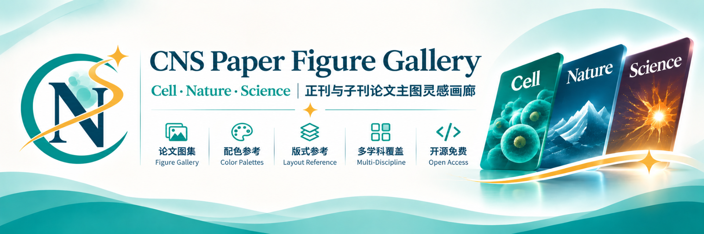

<div align="center">

<p align="center">🌐 <strong>简体中文</strong> · <a href="README.en.md">English</a></p>



# 🎨 CNS 顶刊论文主图灵感画廊
### Cell · Nature · Science 正刊与子刊论文主图灵感画廊 · 全学科 · 2024–2026

### 💖 寻求赞助与资源支持

**让科研绘图灵感持续开放，让全学科配色与版式参考触手可及。**

欢迎个人与机构提供 **资金赞赏、AI 模型 / API 额度或云算力支持**，用于支持图库持续扩展、每月自动采集维护与配色工具迭代。也欢迎通过点 Star、推荐期刊或分享给课题组同伴支持本项目！

**♡ 个人赞赏支持：[跳转赞赏码](#-支持作者) · 在线支持页：[support.html](https://daydayup-xq.github.io/cns-paper-figure-gallery/support.html)**

[](https://daydayup-xq.github.io/cns-paper-figure-gallery/)


-purple)

[](scripts/crawl_cns_figures.py)
[](LICENSE)
[](#-%E7%89%88%E6%9D%83)


<p align="center">🌐 <strong>简体中文</strong> · <a href="README.en.md">English</a></p>

画论文主图前，先看 Cell、Nature、Science 怎么排版与配色。  
一个可搜索、可多维筛选、可一键提取实测色卡的 Figure 1 / Graphical Abstract 画廊。纯静态、零构建、可离线打开。

[🌐 在线画廊](https://daydayup-xq.github.io/cns-paper-figure-gallery/) ·
[🎨 实测色卡提取](#-实测色卡提取) ·
[🤖 Agent 静态接口](#-agent-静态接口beta) ·
[📊 收录规模](#-收录规模) ·
[🧭 视觉模式](#-视觉模式) ·
[🚀 快速开始](#-快速开始) ·
[♡ 支持作者](#-支持作者)

</div>

## 🤝 赞助伙伴

感谢以下赞助伙伴为本项目生态与科研效率工具提供支持。点击横幅或链接即可访问，完整说明可展开查看。

<table>
  <tr>
    <td width="50%" valign="top">
      <a href="https://xqai.top"><strong>XQAI · AI 会员自助充值中心</strong></a><br>
      <a href="https://xqai.top"></a><br>
      <sub>ChatGPT Plus / Pro 24 小时自助充值 · 无需密码｜<a href="https://xqai.top"><strong>访问 xqai.top ↗</strong></a></sub>
      <details>
        <summary><sub>详细介绍与使用说明</sub></summary>
        <p>感谢 <strong>XQAI (https://xqai.top)</strong> 对本项目的赞助支持！</p>
        <ul>
          <li><strong>安全自助充值，告别代充风险</strong>：全程官方卡密自助操作，<b>无需向第三方提供账号密码</b>，避免手工代充导致的封号与隐私风险。</li>
          <li><strong>24 小时全自动开通/续费</strong>：支持 ChatGPT Plus 与 ChatGPT Pro 会员自助充值，论文投稿冲刺与日常科研随时可用。</li>
          <li><strong>科研绘图高效搭档</strong>：在本画廊筛选出目标顶刊的 <code>Figure 1</code> 构图与 <code>Python / R</code> 实测 HEX 色卡后，可直接交由 ChatGPT Plus / Pro 生成高质量 <code>matplotlib</code> / <code>ggplot2</code> / TikZ 代码并润色英文图注。</li>
        </ul>
        <a href="https://xqai.top">立即访问 XQAI 自助充值中心 ↗</a>
      </details>
    </td>
    <td width="50%" valign="top">
      <a href="#-支持作者"><strong>💖 虚位以待 · 成为赞助伙伴</strong></a><br><br>
      <sub>欢迎科研 AI 工具、云计算、API 平台及学术社区联系赞助或资源支持，共同维持开源顶刊图库持续免费开放。</sub><br><br>
      <sub>👉 <a href="#-支持作者">请作者喝杯咖啡 ☕</a> · <a href="https://daydayup-xq.github.io/cns-paper-figure-gallery/support.html">支持与赞助页面 ↗</a></sub>
    </td>
  </tr>
</table>

<sub>赞助伙伴介绍由合作方提供，服务详情、价格与可用性以伙伴官网实时页面为准。</sub>

---

**CNS 顶刊论文主图灵感画廊**收录 **Cell、Nature、Science 三大正刊及 65 本高影响力学科学专刊** 最近三年（2024–2026）的 **5,270 张 Open Access** 论文主图（`Figure 1` 与 `Graphical Abstract`）。它是面向科研人员的构图与配色灵感索引，而不是论文评价排行。每张卡片直连原文 DOI / PMC，并自动标注出版体系、期刊级别、学科方向、视觉模式与实测 5 色色卡。

- **顶部一键筛选工作台**：打开画廊无需跨屏操作，顶部集成 `全部 · Cell · Nature · Science · ★正刊` 快捷点击统计胶囊、热门研究关键词快选（`CRISPR` / `Single-cell` / `Perovskite` / `Diffusion` / `Cryo-EM` / `Quantum`）、68 本期刊下拉筛选、已选条件面包屑（点击单项清除）以及可一键折叠/展开的筛选芯片栏。
- **全景多视图展示**：自由切换 **`瀑布流`**、**`等高`** 与高密度 **`紧凑图墙`** 三种视图，支持正刊优先、最新年份、高引用与标题排序。
- **无遮挡期刊化卡片 & 色板直取**：每张卡片顶部以彩色边栏区分 `Cell / Nature / Science` 体系并标注期刊与 `Fig. 1 / GA`，完全不遮挡图片内容；底部提供连续 5 色实测色条（自动去除纯白/纯黑背景），支持单点复制 HEX 与一键复制 `Py` 列表。
- **灯箱大图检视**：点击进入 1:1 高清放大与官方高分辨率原图（`highres`），支持键盘 `←` / `→` 翻页、`Esc` 退出，以及 **Python / R / CSS** 代码导出、`复制 BibTeX` 与 `DOI / PMC` 原文直达。
- **中英双语 & 深浅色主题 & URL 分享**：顶部支持一键切换 **中文 / English** 与 **☀️ / 🌙 深浅主题**，所有筛选条件实时同步到 URL（如 `?family=cell&tier=flagship&y=2026`）。
- **100% Open Access 官方 CDN 直链**：所有图片直接引用 Elsevier、Springer Nature 与 NCBI PMC Open Data (`pmc-oa-opendata`) 官方图床，保留完整署名与开源许可。

---

## 📊 收录规模

当前全库共收录 **5,270 张** 2024–2026 年 Open Access 主图，覆盖配置中的全部 **68 本** CNS 正刊与子刊：

| 出版体系 | 2024 | 2025 | 2026 | 主图合计 | ★ 三大正刊 | 核心专刊大子刊 | 综合 / 小子刊 |
|---|---:|---:|---:|---:|---:|---:|---:|
| 🟢 **Cell Press** | 365 | 481 | 973 | **1,819** | 884 | 905（21 本） | 30（*iScience* / *Cell Rep*） |
| 🔴 **Nature Portfolio** | 467 | 634 | 1,534 | **2,635** | 1,100 | 1,505（36 本） | 30（*Nat Commun*） |
| 🔵 **Science Family** | 277 | 293 | 246 | **816** | 150 | 74（4 本） | 592（*Sci Adv*） |
| **总计** | **1,109** | **1,408** | **2,753** | **5,270** | **2,134** | **2,484** | **652** |

### 按学科方向划分

| 学科方向 | 数量 | 占比 | 核心覆盖方向与示例链接 |
|---|---:|---:|---|
| 🧬 **生命科学与医学** (`bio-med`) | **3,090** | 58.6% | 结构生物、免疫肿瘤、神经科学、单细胞、临床医学 · [浏览 ↗](https://daydayup-xq.github.io/cns-paper-figure-gallery/?discipline=bio-med) |
| ⚛️ **物理、光学与工程** (`phys-eng`) | **596** | 11.3% | 量子信息、光子学、柔性电子、机器人、天体物理 · [浏览 ↗](https://daydayup-xq.github.io/cns-paper-figure-gallery/?discipline=phys-eng) |
| ⚡ **能源、地球与环境** (`energy-env`) | **466** | 8.8% | 二次电池、光伏催化、气候变化、水资源与可持续发展 · [浏览 ↗](https://daydayup-xq.github.io/cns-paper-figure-gallery/?discipline=energy-env) |
| 🧪 **材料与化学纳米** (`mat-chem`) | **465** | 8.8% | 有机/无机合成、纳米催化、MOF/COF、高分子与器件化学 · [浏览 ↗](https://daydayup-xq.github.io/cns-paper-figure-gallery/?discipline=mat-chem) |
| 🤖 **AI 与计算科学** (`ai-comp`) | **446** | 8.5% | 科学基础模型、AI4Science、生物信息算法、计算神经 · [浏览 ↗](https://daydayup-xq.github.io/cns-paper-figure-gallery/?discipline=ai-comp) |
| 🌐 **交叉与行为社会** (`inter-soc`) | **207** | 3.9% | 人类行为、心理学、心理健康、城市系统与交叉学科 · [浏览 ↗](https://daydayup-xq.github.io/cns-paper-figure-gallery/?discipline=inter-soc) |

<details>
<summary>📚 <strong>展开查看全部 68 本已收录期刊明细</strong></summary>

- **🟢 Cell 系列（24 本 · 1,819 张）**：*Cell* (884) · *Patterns* (103) · *Cancer Cell* (72) · *Cell Reports Medicine* (61) · *Immunity* (51) · *Cell Genomics* (50) · *Cell Systems* (50) · *Molecular Cell* (50) · *Neuron* (49) · *Cell Stem Cell* (46) · *Current Biology* (46) · *Cell Chemical Biology* (45) · *Med* (43) · *Cell Host & Microbe* (41) · *Developmental Cell* (40) · *Cell Metabolism* (37) · *Structure* (33) · *Device* (28) · *iScience* (28) · *Joule* (21) · *Chem* (18) · *Matter* (11) · *One Earth* (10) · *Cell Reports* (2)
- **🔴 Nature 系列（38 本 · 2,635 张）**：*Nature* (1,100) · *Nature Methods* (126) · *Nature Medicine* (106) · *Nature Physics* (91) · *Nature Human Behaviour* (81) · *Nature Machine Intelligence* (67) · *Nature Chemistry* (60) · *Nature Aging* (53) · *Nature Astronomy* (49) · *Nature Mental Health* (49) · *Nature Ecology & Evolution* (48) · *Nature Genetics* (48) · *Nature Structural & Molecular Biology* (47) · *Nature Chemical Biology* (46) · *Nature Geoscience* (46) · *Nature Photonics* (46) · *Nature Climate Change* (40) · *Nature Materials* (39) · *Nature Microbiology* (38) · *Nature Nanotechnology* (36) · *Nature Plants* (36) · *Nature Communications* (30) · *Nature Cities* (29) · *Nature Cancer* (28) · *Nature Sustainability* (28) · *Nature Computational Science* (27) · *Nature Neuroscience* (27) · *Nature Cell Biology* (26) · *Nature Cardiovascular Research* (25) · *Nature Energy* (25) · *Nature Electronics* (22) · *Nature Catalysis* (21) · *Nature Synthesis* (21) · *Nature Biotechnology* (18) · *Nature Food* (18) · *Nature Immunology* (17) · *Nature Water* (13) · *Nature Biomedical Engineering* (8)
- **🔵 Science 系列（6 本 · 816 张）**：*Science Advances* (592) · *Science* (150) · *Science Translational Medicine* (35) · *Science Immunology* (31) · *Science Signaling* (7) · *Science Robotics* (1)

</details>

---

## 🧭 视觉模式

标签描述图的视觉表达功能，帮助按构图形式而不是仅按关键词找参考：

| 标签 | 数量 | 含义与构图参考场景 | 直达筛选 |
|---|---:|---|---|
| 🎯 `graphical-abstract` | **433** | 单图视觉摘要（GA），用一眼看懂的概览凝练研究核心发现（含大量 Cell 系 `fx1` 官方摘要图） | [筛选 ↗](https://daydayup-xq.github.io/cns-paper-figure-gallery/?pattern=graphical-abstract) |
| 🔬 `mechanism` | **757** | 分子结合机制、催化循环、细胞或神经信号通路示意图 | [筛选 ↗](https://daydayup-xq.github.io/cns-paper-figure-gallery/?pattern=mechanism) |
| 📐 `pipeline` | **554** | 端到端实验路线、系统架构、AI 模型流程或研究框架图 | [筛选 ↗](https://daydayup-xq.github.io/cns-paper-figure-gallery/?pattern=pipeline) |
| 🧩 `multipanel` | **2,875** | 典型顶刊 `a/b/c/d` 组合主图，兼顾概念示意与关键实验曲线/表征 | [筛选 ↗](https://daydayup-xq.github.io/cns-paper-figure-gallery/?pattern=multipanel) |
| 🗺️ `characterization` | **651** | 冷冻电镜分子结构、空间转录组图谱、材料微观表征及地图分布 | [筛选 ↗](https://daydayup-xq.github.io/cns-paper-figure-gallery/?pattern=characterization) |

---

## 🎨 实测色卡提取

每张卡片底部直接展示 5 色实测调色板与 `Py` 一键复制按钮；点击右上角 **「🎨 顶刊色卡库」** 可按当前筛选结果实时查看前 36 篇同领域顶刊论文色板；在 **Lightbox 大图弹窗** 内支持直接导出 **Python / R / CSS** 代码片段：

```python
# 在卡片点击 "Py" 或 Lightbox 点击 "Python" 后直接用于 matplotlib / seaborn
import seaborn as sns
palette = ["#2b5c8f", "#c84b31", "#2e8b57", "#d98c26", "#724e98"]
sns.set_palette(palette)
```

```r
# Lightbox 点击 "R" 后直接用于 ggplot2
library(ggplot2)
palette <- c("#2b5c8f", "#c84b31", "#2e8b57", "#d98c26", "#724e98")
scale_color_manual(values = palette)
```

---

## 🤖 Agent 静态接口（Beta）

为方便科研绘图 Agent、脚本工作流或浏览器插件直接读取经视觉核对的正刊精选色板与版式骨架，站点发布目录内置了纯静态 JSON 接口（`schema_version: "1.0"`，无需鉴权，CORS 友好的 GitHub Pages 静态文件）：

| 接口路径 | 用途说明 | 在线访问示例 |
|---|---|---|
| `api/v1/index.json` | 轻量检索清单（含 `id`、`journal`、`year`、`discipline`、`figure_type`、`item_api_url`、`primary_colors`） | [`index.json`](https://daydayup-xq.github.io/cns-paper-figure-gallery/api/v1/index.json) |
| `api/v1/curated.json` | 全量精选合集（一次性返回全部已核对条目完整字段，适合批量上下文注入） | [`curated.json`](https://daydayup-xq.github.io/cns-paper-figure-gallery/api/v1/curated.json) |
| `api/v1/items/{id}.json` | 单图详情接口（含论文元数据、高清原图直链、语义分角色色板与中文版式说明） | [`nature-2025-pmc11711098.json`](https://daydayup-xq.github.io/cns-paper-figure-gallery/api/v1/items/nature-2025-pmc11711098.json) |

### 单图接口字段结构示例

```json
{
  "schema_version": "1.0",
  "id": "nature-2025-pmc11711098",
  "meta": {
    "title": "Accurate predictions on small data with a tabular foundation model",
    "journal": "Nature",
    "journal_tier": "flagship",
    "year": 2025,
    "discipline": "ai-comp",
    "figure_type": "pipeline"
  },
  "links": {
    "gallery_page": "https://daydayup-xq.github.io/cns-paper-figure-gallery/#fig=nature-2025-pmc11711098",
    "image_hd": "https://media.springernature.com/full/springer-static/image/art%3A10.1038%2Fs41586-024-08328-6/MediaObjects/41586_2024_8328_Fig1_HTML.png",
    "doi": "https://doi.org/10.1038/s41586-024-08328-6",
    "pmc": "https://pmc.ncbi.nlm.nih.gov/articles/PMC11711098/"
  },
  "palette": {
    "roles": {
      "primary": ["#7BAFCD", "#FF9263", "#D5E0EF", "#DFEEE8"],
      "accent": "#FF9263",
      "neutral": "#7F7F7F",
      "background": "#FFFFFF"
    },
    "colorblind_safe": true
  },
  "reference": {
    "layout_notes": "上下两段式 AI 框架总览：上方左右并列浅蓝与浅薄荷圆角分区对照预训练与实测推理，下方按从左到右数据流展示表格输入、2D TabPFN 注意力层与预测分布直方图，以珊瑚橙高亮待预测目标条目。"
  }
}
```

- **双层色系兼容**：未核对条目保留原有 `palette` 自动提取色系；已通过视觉核对的条目在 `data/figures.json` 中新增 `palette_curated`（`status: "verified"`），画廊卡片自动优先展示精选角色色块并附带 `✨ 精选色系` 与 `Agent JSON ↗` 入口。
- **确定性同步构建**：新增或修改 `palette_curated` 后，运行以下命令即可同步更新 `api/v1/` 与 `assets/figures.js`：

```bash
python -X utf8 scripts/build_agent_api.py
python -X utf8 scripts/validate_gallery.py
```

---

## 🚀 快速开始

在线浏览：**[GitHub Pages 在线画廊](https://daydayup-xq.github.io/cns-paper-figure-gallery/)**

本地运行或复现采集：

```bash
git clone https://github.com/daydayup-xq/cns-paper-figure-gallery.git
cd cns-paper-figure-gallery

# 方式一：本地 HTTP 服务预览（或直接双击打开 index.html）
python -m http.server 8080

# 方式二：增量采集最近三年 Open Access CNS 主图（需 requests、pillow）
python -X utf8 scripts/crawl_cns_figures.py --merge --target-total 5500 --workers 32
python -X utf8 scripts/validate_gallery.py
```

- **每月自动更新**：仓库内置 [`.github/workflows/update-figures.yml`](.github/workflows/update-figures.yml) 与 [`.github/workflows/deploy-pages.yml`](.github/workflows/deploy-pages.yml)，每月 1 日 03:00 UTC（北京时间 11:00）自动增量采集最新 OA 主图并发布新版 **GitHub Pages**。

## 🗃️ 仓库结构

```text
├── index.html                  # 画廊主页（顶部筛选工作台 / 多视图 / 灯箱 / 配色库 / 支持作者弹窗）
├── support.html                # 独立赞赏支持与赞助伙伴页面（中英双语）
├── README.md / README.en.md    # 中英文项目文档
├── api/v1/
│   ├── index.json              # Agent 轻量精选索引清单
│   ├── curated.json            # Agent 全量精选数据包
│   └── items/{id}.json         # 单图完整元数据、角色色板与版式参考接口
├── assets/
│   ├── style.css / app.js      # 样式与前端交互逻辑
│   ├── i18n.js                 # 中英文切换词典
│   ├── figures.js              # 前端内联数据集（由 data/figures.json 同步生成）
│   ├── logo.png / favicon.png  # 网站品牌 Logo 与浏览器图标
│   └── wechat-pay.jpg          # 作者赞赏收款码
├── data/
│   ├── journals.json           # 68 本 CNS 期刊配置与学科映射表
│   └── figures.json            # 全量 5,270 条 OA 主图权威清单（含可选 palette_curated）
├── docs/                       # 项目横幅与赞助伙伴视觉资产
├── scripts/
│   ├── crawl_cns_figures.py    # OpenAlex + NCBI E-Utilities + 官方 CDN 采集与色板提取管线
│   ├── build_agent_api.py      # 从 palette_curated 生成 /api/v1/ 并同步 assets/figures.js
│   └── validate_gallery.py     # 数据完整性、Agent API 与静态资源校验
└── .github/workflows/          # Pages 部署与每月定时增量更新工作流
```

## ⚠️ 版权

论文元数据来自 [OpenAlex](https://openalex.org/) 与 [NCBI E-Utilities](https://www.ncbi.nlm.nih.gov/books/NBK25500/)，所有图像均直接外链自 Elsevier (`ars.els-cdn.com`)、Springer Nature (`media.springernature.com`) 与 AWS Open Data `pmc-oa-opendata` (`pmc-oa-opendata.s3.amazonaws.com`)。图片版权归原作者及各自出版方所有，仅作非商业科研学习与版式参考索引，遵循原论文对应的 CC BY / Open Access 协议；本站前端与工具代码采用 [MIT License](LICENSE) 开源。

## 📌 引用

```bibtex
@misc{cns_paper_figure_gallery,
  title  = {CNS Paper Figure Gallery: An All-Discipline Open Access Gallery of Figure 1 and Graphical Abstracts from Cell, Nature, and Science (2024--2026)},
  year   = {2026},
  url    = {https://github.com/daydayup-xq/cns-paper-figure-gallery}
}
```

<details>
<summary><strong>🖼️ 精选图录（Cell · Nature · Science 2026 示例）</strong></summary>

完整 5,270 张主图请访问 [在线画廊](https://daydayup-xq.github.io/cns-paper-figure-gallery/)。以下图片均直链自出版商或 PMC 官方 Open Access 图床，点击标题可跳转原论文：

| <a href="https://doi.org/10.1016/j.cell.2026.01.026"></a><br><sub><strong>Cell</strong> (2026) · <a href="https://doi.org/10.1016/j.cell.2026.01.026">PLANeT: Understanding and leveraging the genome of land plants for a sustainable future</a></sub> | <a href="https://doi.org/10.1038/s41586-025-09064-1"></a><br><sub><strong>Nature</strong> (2026) · <a href="https://doi.org/10.1038/s41586-025-09064-1">Tracing the spread of Germanic languages using ancient genomics</a></sub> | <a href="https://doi.org/10.1126/science.adx4174"></a><br><sub><strong>Science</strong> (2026) · <a href="https://doi.org/10.1126/science.adx4174">Inherited resilience to clonal hematopoiesis by modifying stem cell RNA regulation</a></sub> |
|---|---|---|
| <a href="https://doi.org/10.1016/j.ccell.2026.05.008"></a><br><sub><strong>Cancer Cell</strong> (2026) · <a href="https://doi.org/10.1016/j.ccell.2026.05.008">Pathogenesis of diffuse large B cell lymphoma proteogenotypes</a></sub> | <a href="https://doi.org/10.1038/s43587-026-01125-y"></a><br><sub><strong>Nature Aging</strong> (2026) · <a href="https://doi.org/10.1038/s43587-026-01125-y">A unifying model of stem cell dynamics explains age-related methylation patterns across mammals</a></sub> | <a href="https://doi.org/10.1126/sciimmunol.ads9407"></a><br><sub><strong>Science Immunology</strong> (2026) · <a href="https://doi.org/10.1126/sciimmunol.ads9407">The OAS–RNase L pathway: Insights from experiments of nature</a></sub> |

</details>

## ♡ 支持作者

### 请作者喝杯咖啡 ☕

如果这个画廊帮你找到了顶刊论文配图与配色灵感，欢迎随意支持，帮助我持续整理主图、更新数据和维护工具。

<table>
  <tr>
    <td align="center" valign="top"><strong>微信支付</strong><br><a href="assets/wechat-pay.jpg"></a></td>
    <td align="center" valign="top"><strong>赞助伙伴 · XQAI</strong><br><a href="https://xqai.top"></a><br><br><sub>ChatGPT Plus / Pro 24h 全自动自助充值：<a href="https://xqai.top"><strong>https://xqai.top ↗</strong></a></sub></td>
  </tr>
</table>

<sub>点击微信收款码可查看原图；手机浏览可保存图片，在微信扫一扫中从相册选择。也可访问网页端 <a href="https://daydayup-xq.github.io/cns-paper-figure-gallery/support.html">支持页面 ↗</a>。</sub>

打赏完全自愿，金额随意。感谢你的支持，点个 **Star**、分享给同伴和提 Issue 反馈也同样重要。

## 🙏 致谢

- 灵感致谢：本项目在立项设计、开源展示形式与部分使用引导思路上，深受开源项目 [Top-Conf Figure Gallery (`qwdwqfwq/topconf-paper-figure-gallery`)](https://github.com/qwdwqfwq/topconf-paper-figure-gallery) 启发，在此向原作者表达诚挚感谢。
- 数据与开放获取支持：感谢 [OpenAlex](https://openalex.org/) 提供开放文献检索接口，以及 [NCBI E-Utilities](https://www.ncbi.nlm.nih.gov/books/NBK25501/) 与 [PubMed Central Open Access Subset](https://pmc.ncbi.nlm.nih.gov/tools/openftlist/) 提供的开放获取论文与配图数据支持。
- 技术与设计参考：感谢所有为科研绘图、数据可视化与开源社区贡献工具与灵感的开发者与科研作者。

